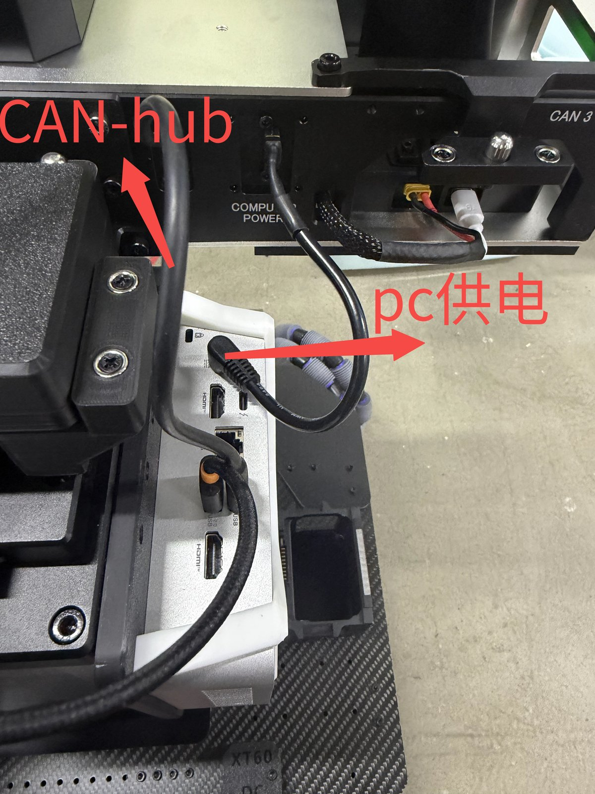
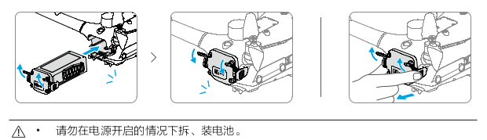
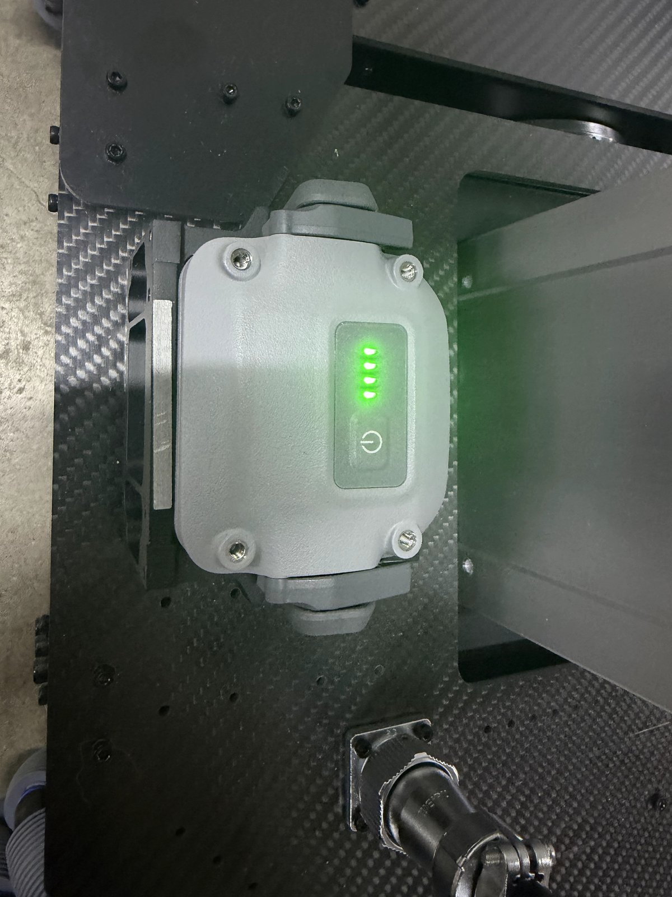
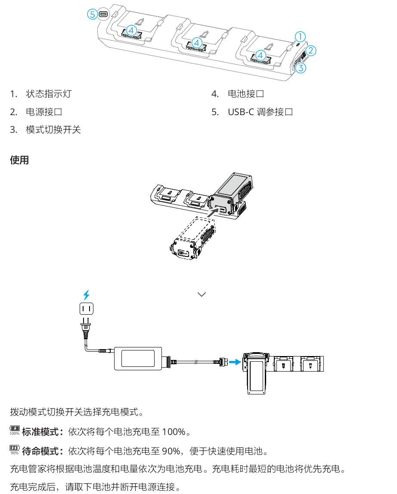
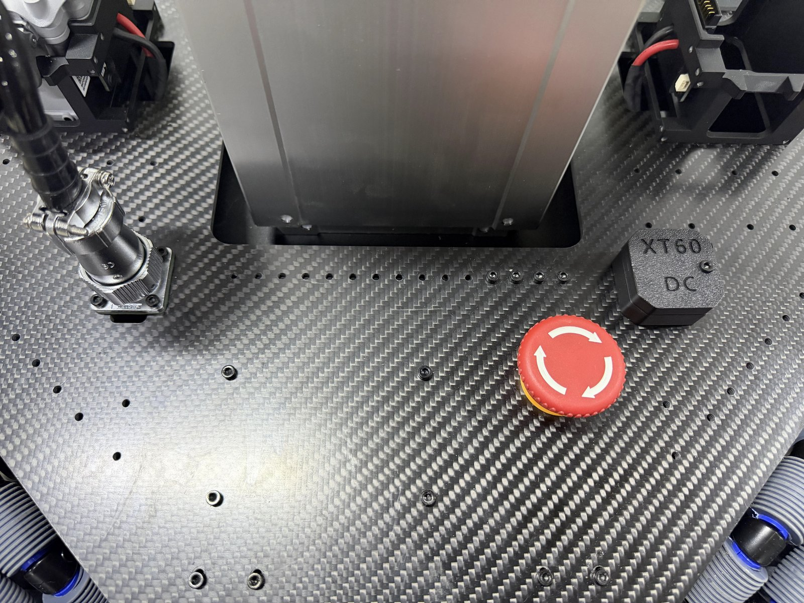
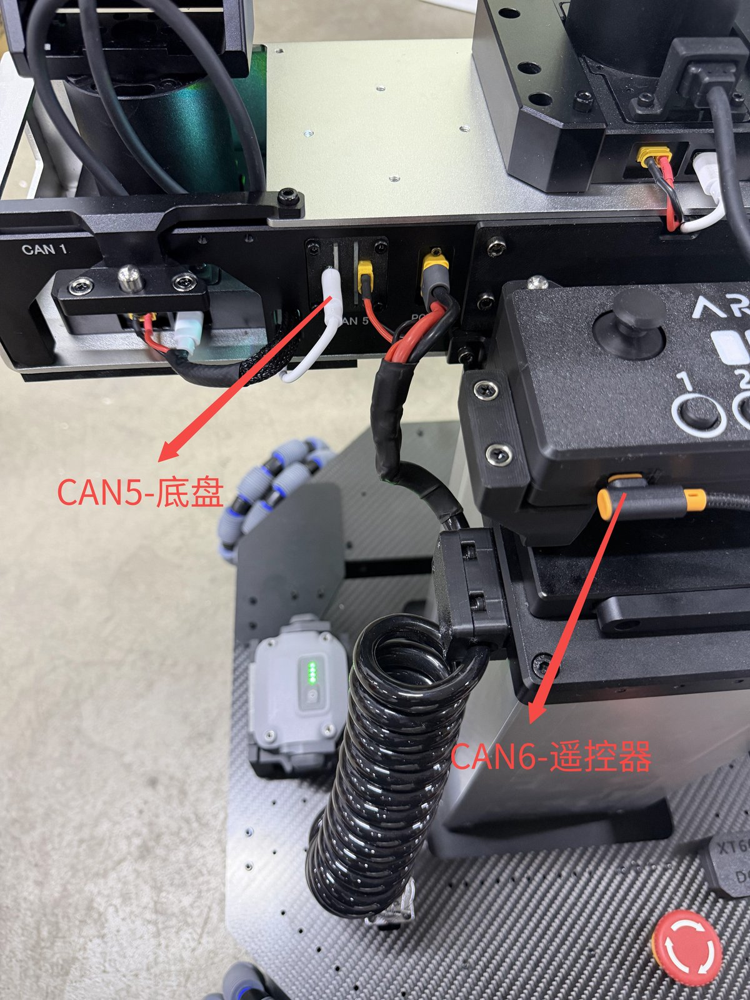
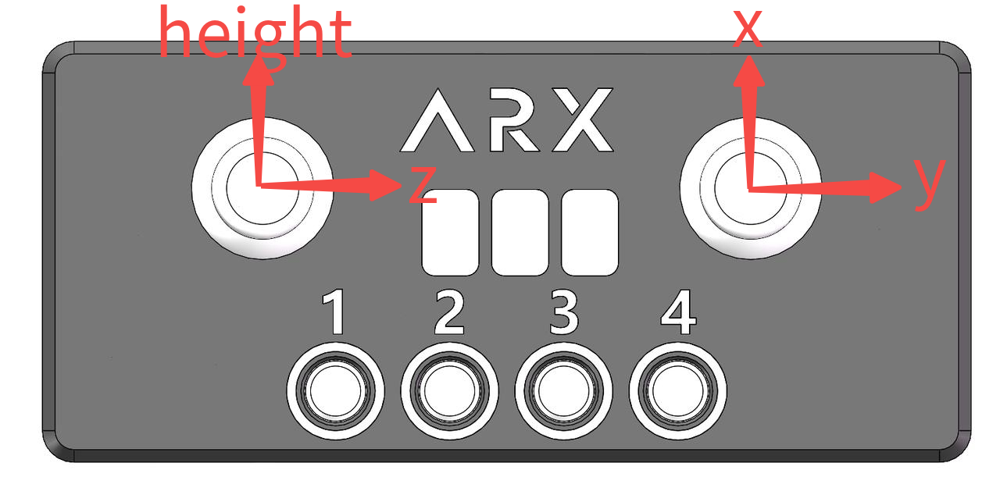
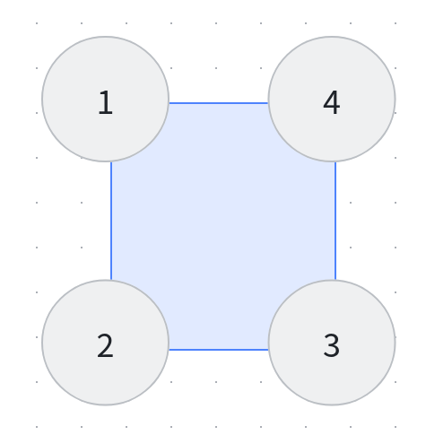

# LIFT-mini-SDK-V2

**English** | [简体中文](README.zh-CN.md)

## Environment Setup

Same as the single-arm environment setup — refer to the **A5 SDK**.

## Hardware Connection

<p align="center">
  
</p>
<p align="center"><em>CAN hub and PC power connections</em></p>

### Battery Installation & Charging

The device uses a dual-battery pack and supports hot swapping for quick battery replacement.

<p align="center">
  
</p>
<p align="center"><em>Battery removal / installation — do not swap batteries while the power is on</em></p>

<p align="center">
  
  &nbsp;&nbsp;
  
</p>
<p align="center"><em>Left: battery installed (charge indicator) &nbsp;|&nbsp; Right: charging dock</em></p>

> [!WARNING]
> - Before powering on, make sure the emergency stop switch is **released (twisted open)** in advance.
> - In an emergency, press the emergency stop switch with your foot or a tool. Be aware that the lift column will **drop when power is cut**.

<p align="center">
  
</p>
<p align="center"><em>Emergency stop switch</em></p>

## CAN Configuration

Same as the single-arm setup. When configuring, connect the target device **individually**.

| Device            | CAN Port |
| ----------------- | -------- |
| Head              | CAN0     |
| Left arm          | CAN1     |
| Right arm         | CAN3     |
| Chassis           | CAN5     |
| Remote controller | CAN6     |

<p align="center">
  
</p>
<p align="center"><em>CAN5 → chassis &nbsp;|&nbsp; CAN6 → remote controller</em></p>

## Demo

### Remote Controller

Start the CAN devices as described in the A5 SDK (chassis on `can5`, remote controller on `can6`), then run from the `LIFT-mini/` directory:

```bash
python3 demo_joy.py
```

<p align="center">
  
</p>
<p align="center"><em>Remote controller axis mapping</em></p>

## SDK

### Get Height

```python
robot.get_height()
```

### Set Height

Range: `0 – 0.38`, unit: m

```python
robot.set_height(set_lift_height)
```

### Chassis Velocity Control

Unit: m/s

```python
# Set chassis velocity x, y, z; mode = 1 for overall velocity control (m/s)
robot.set_chassis_cmd(0, 0, 0, 1)
```

### Wheel Velocity Control & Feedback

Unit: rad/s

<p align="center">
  
</p>
<p align="center"><em>Wheel numbering</em></p>

```python
# Wheel velocity control: set mode to 3
robot.set_chassis_cmd(0, 0, 0, 3)
robot.set_wheel_vel(1, 0, 0, 0)

get_wheel_vel = robot.get_wheel_vel()
```
