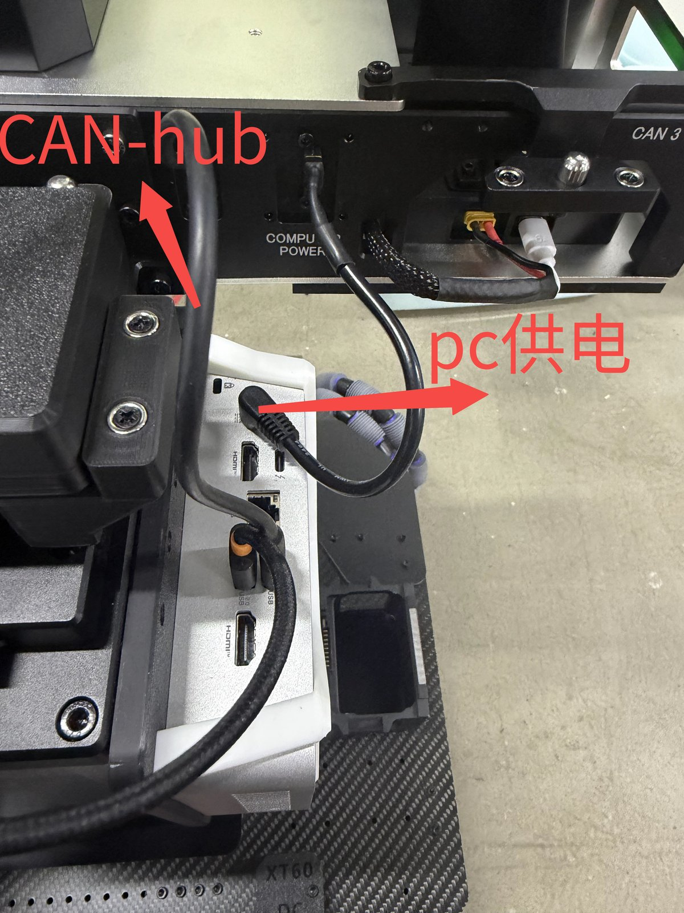
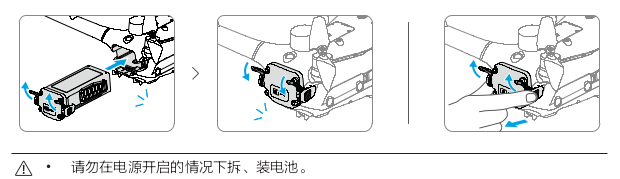
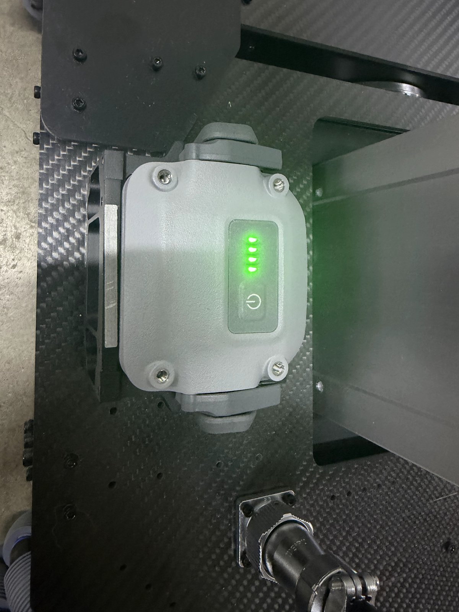
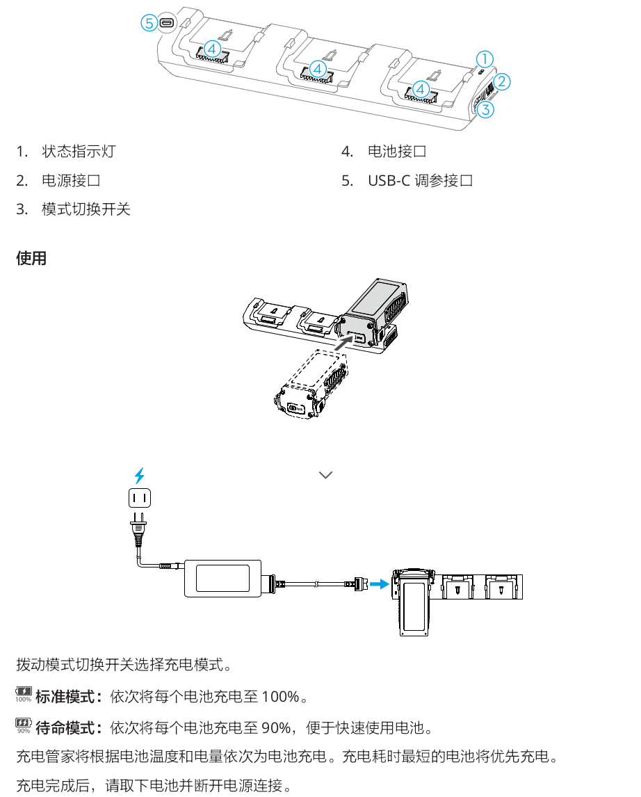
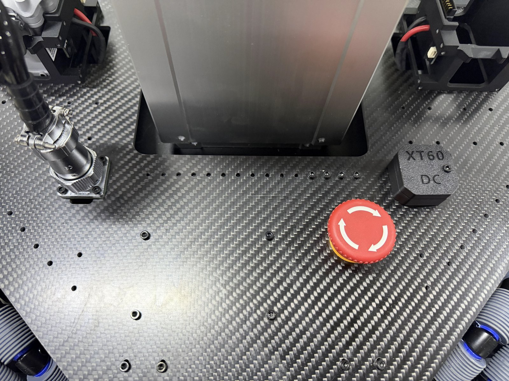
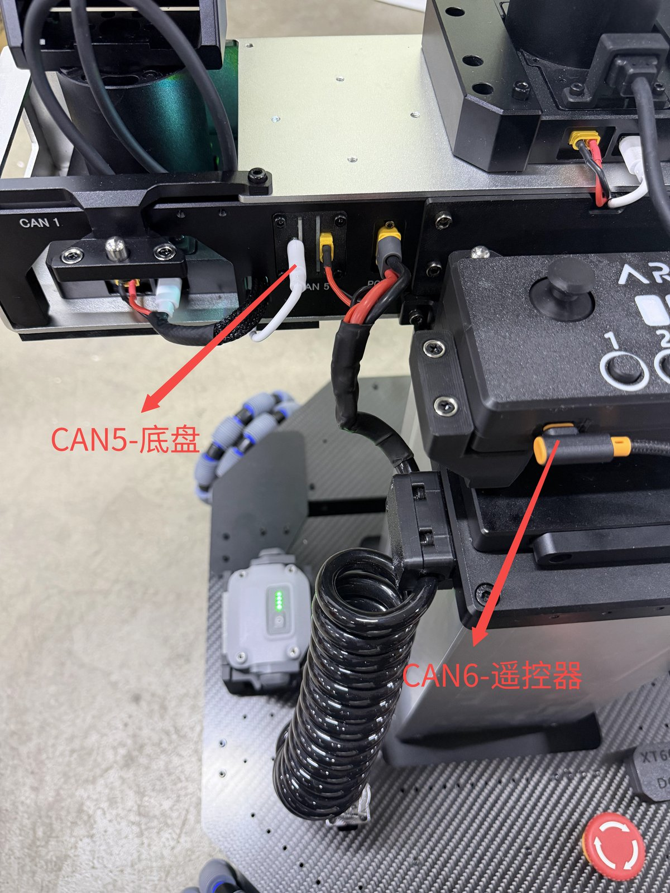
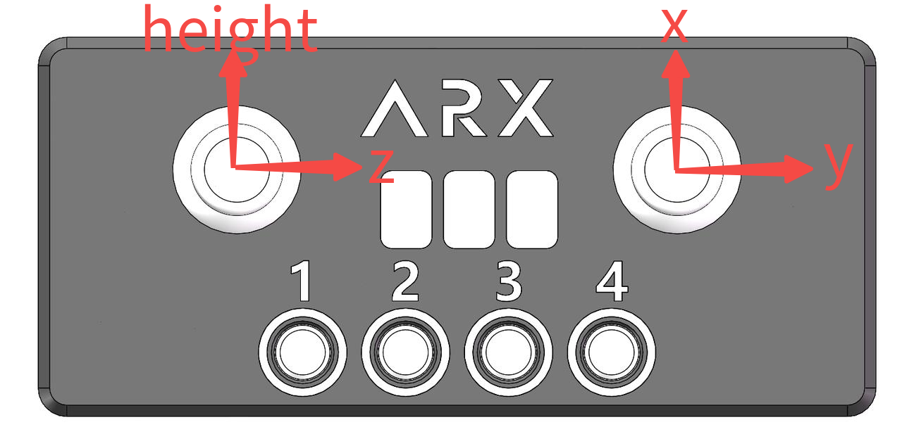
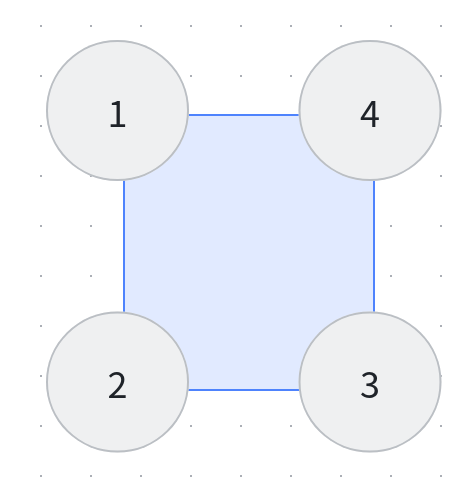

# LIFT-mini-SDK-V2

[English](README.md) | **简体中文**

## 环境配置

与单臂环境配置一致，参考 **A5 SDK**。

## 硬件连接

<p align="center">
  
</p>
<p align="center"><em>CAN-hub 与 PC 供电连接</em></p>

### 电池安装与充电

本设备采用双电池组，支持热拔插进行快速替换。

<p align="center">
  
</p>
<p align="center"><em>电池拆装步骤 —— 请勿在电源开启的情况下拆、装电池</em></p>

<p align="center">
  
  &nbsp;&nbsp;
  
</p>
<p align="center"><em>左：电池安装到位（电量指示灯） &nbsp;|&nbsp; 右：充电座使用说明</em></p>

> [!WARNING]
> - 启动时请提前将急停开关**旋开**。
> - 出现紧急情况时，用脚或工具将急停开关按下；注意断电时升降设备会**坠落**。

<p align="center">
  
</p>
<p align="center"><em>急停开关</em></p>

## CAN 配置

同单臂设置，配置时目标设备需**单独连接**。

| 设备   | CAN 口 |
| ------ | ------ |
| 头部   | CAN0   |
| 左臂   | CAN1   |
| 右臂   | CAN3   |
| 底盘   | CAN5   |
| 遥控器 | CAN6   |

<p align="center">
  
</p>
<p align="center"><em>CAN5 → 底盘 &nbsp;|&nbsp; CAN6 → 遥控器</em></p>

## Demo

### 遥控器控制

参考 A5 SDK 启动 CAN 设备（底盘 `can5`，遥控器 `can6`），然后在 `LIFT-mini/` 目录下运行：

```bash
python3 demo_joy.py
```

<p align="center">
  
</p>
<p align="center"><em>遥控器轴向说明</em></p>

## SDK

### 高度值获取

```python
robot.get_height()
```

### 高度设定

范围 `0 – 0.38`，单位：m

```python
robot.set_height(set_lift_height)
```

### 整体速度控制

单位：m/s

```python
# 设置底盘速度 x y z，mode = 1 为整体速度控制，单位 m/s
robot.set_chassis_cmd(0, 0, 0, 1)
```

### 轮组速度控制及反馈

单位：rad/s

<p align="center">
  
</p>
<p align="center"><em>轮组编号</em></p>

```python
# 轮速控制，设置模式为 3
robot.set_chassis_cmd(0, 0, 0, 3)
robot.set_wheel_vel(1, 0, 0, 0)

get_wheel_vel = robot.get_wheel_vel()
```
